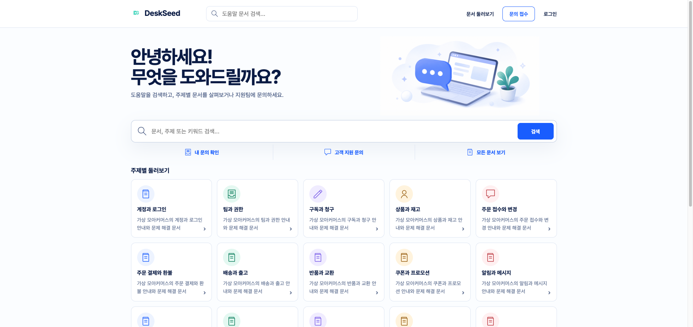
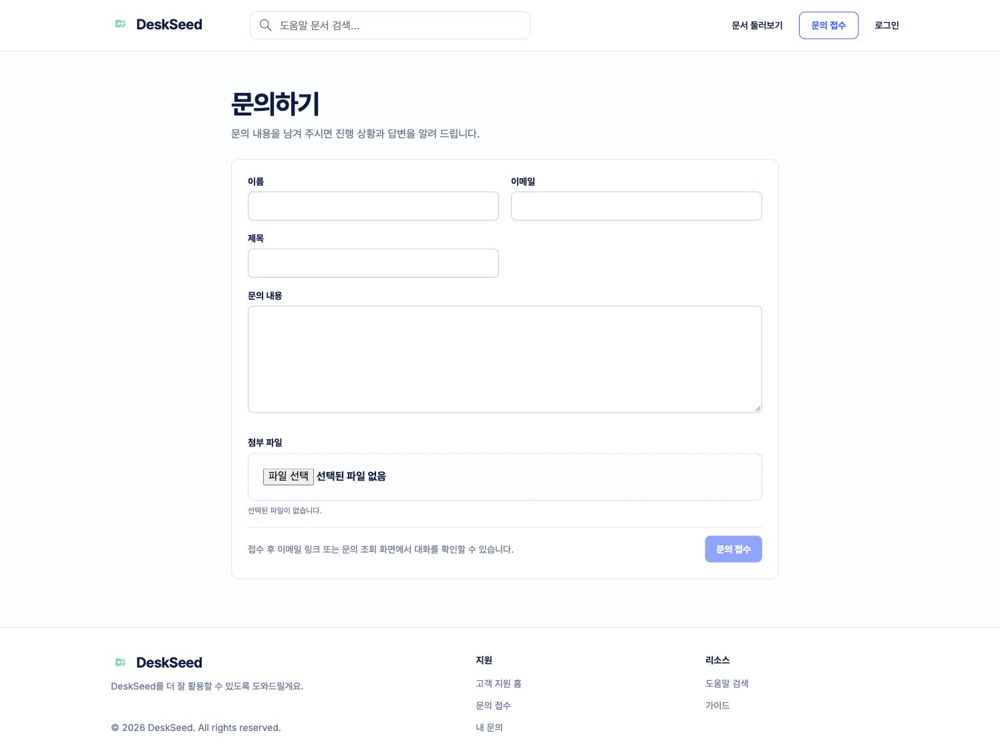
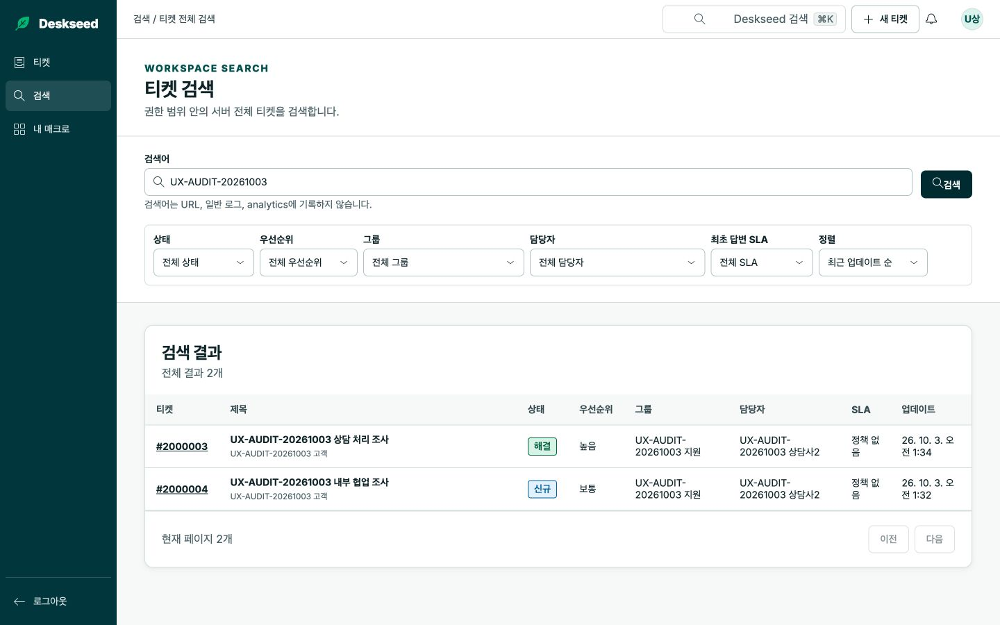
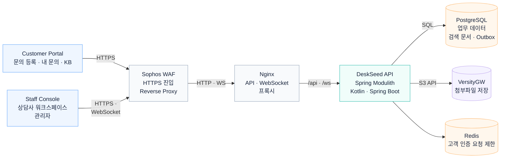

# DeskSeed

**고객 문의 접수부터 상담사 답변·검색·이관·감사 기록까지 구현한 고객지원 시스템**

고객지원 운영 경험을 바탕으로 만든 개인 프로젝트입니다. 상담사는 티켓을 검색하고 답변하거나 다른 담당자에게 넘길 수 있습니다. 여러 상담사가 같은 티켓을 수정할 때 변경 내용이 덮어쓰이지 않도록 처리했습니다.

**Kotlin · Java 21 · Spring Boot · Spring Modulith · PostgreSQL · React/TypeScript**

[실행 방법](#로컬-실행과-테스트) · [아키텍처](#아키텍처) · [고객·직원 화면 분리](docs/adr/0044-customer-portal-frontend-surface-isolation.md) · [Core API](api/core-api-outline-v1.yaml)

## 화면 둘러보기



고객은 메인 화면에서 도움말을 검색하거나 주제별 문서를 살펴보고, 해결되지 않은 내용은 문의로 접수할 수 있습니다.

| 고객 문의 등록 | 상담사 티켓 검색 |
| --- | --- |
|  |  |

## 주요 기능

- **고객 계정:** 이메일 인증을 거친 회원가입, 비밀번호 로그인·재설정, 비밀번호 미설정 고객용 매직 링크 로그인
- **고객 문의:** 익명 또는 로그인 상태에서 문의 접수, 토큰으로 익명 문의 조회, 로그인 후 내 문의 목록·답변 조회와 추가 답변 작성
- **상담사 화면:** 티켓 검색, Views, 상태·우선순위·담당 그룹 변경, 공개 답변·내부 메모
- **동시 수정:** 버전과 수정한 항목을 비교해 충돌 시 `409` 반환, 작성 중인 답변 보존
- **감사 기록:** 티켓 수정·열람 이력, 권한별 접근, Audit Explorer
- **외부 API:** 허용 네트워크와 API key scope로 접근 제한, 티켓 생성·조회·변경, `Idempotency-Key`와 `If-Match` 처리

## 아키텍처



고객 포털과 직원 콘솔은 공통 API를 사용하며 인증과 조회 데이터를 분리합니다. PostgreSQL은 티켓·감사·검색 데이터를, VersityGW는 첨부파일을 보관합니다. Redis는 고객 인증 요청 제한에 사용합니다.

[전체 구조](docs/architecture/overview.md) · [티켓 수정과 동시 수정 충돌 처리](docs/architecture/ticket-command.md) · [활성·종료 티켓 검색](docs/architecture/ticket-search.md) · [고객 문의 조회와 공개 답변 분리](docs/architecture/customer-read.md)

## 1. 검색할 티켓부터 선택해 JOIN 줄이기

상담사 검색은 PostgreSQL에서 활성 티켓과 종료된 티켓을 나눠 조회합니다. 상태 조건이 없으면 활성 티켓을 먼저 검색하고, 결과가 부족하면 종료된 티켓을 이어서 조회합니다.

**페이지에 보여줄 티켓을 먼저 선택하고**, 선택된 티켓에만 고객·그룹·담당자·SLA 정보를 JOIN합니다. 다음 페이지부터는 cursor로 조회합니다.

**관련 코드**

- [검색 SQL 계획](backend/src/main/kotlin/dev/deskseed/ticketing/internal/StaffTicketSearchSqlPlan.kt)
- [검색 Repository](backend/src/main/kotlin/dev/deskseed/ticketing/internal/StaffTicketQueryRepository.kt)
- [검색 통합 테스트](backend/src/test/kotlin/dev/deskseed/staffaccess/internal/AgentTicketSearchIntegrationTest.kt)

<details>
<summary>2026년 9월 검색 성능 개선 실험 (100만 티켓)</summary>

2026년 9월, **100만 티켓·1 VU·검색 20회**로 스테이징 A/B 테스트를 진행했습니다. 첫 페이지에서 전체 건수를 계산하는 작업을 줄이고, 검색 범위가 넓을 때는 검색어를 추가로 입력하도록 바꿨습니다.

- 검색 응답 p95: **22.056초 → 1.601초**
- 변경 후 검색 결과를 보여준 15건의 p95: **1.158초**

기존에는 20건 모두 검색 결과를 반환했고, 변경 후에는 **15건 검색 결과 + 5건 검색어 추가 안내**를 반환했습니다. 전체 p95 **1.601초**는 두 응답을 함께 계산한 값입니다.

- [검색 개선 PR #237](https://github.com/kdh949/deskseed/pull/237)

</details>

## 2. 여러 상담사가 같은 티켓을 수정할 때

두 상담사가 같은 티켓을 수정해도 앞서 저장된 내용이 덮어써지지 않도록 티켓 버전과 변경한 필드를 비교합니다.

다른 상담사가 먼저 같은 항목을 수정했다면 `409`와 충돌 항목을 반환합니다. 화면에서는 작성하던 답변을 유지하고, 수정 항목이 겹치지 않으면 담당자·그룹 규칙에 따라 변경을 반영합니다.

고객에게 보이는 `PUBLIC` 답변과 상담사만 읽는 `INTERNAL` 메모도 분리했습니다. 티켓 수정과 감사 기록은 같은 DB 트랜잭션에 저장합니다.

- [필드별 충돌 처리와 트랜잭션](backend/src/main/kotlin/dev/deskseed/ticketing/internal/JpaAgentTicketCommandService.kt)
- [충돌 처리와 초안 보존](frontend/apps/staff-console/src/features/ticket-workspace/model/useTicketEditor.ts)

## 3. 변경·열람 기록과 Audit Explorer

티켓을 수정한 사람과 시각, 상담사의 티켓 열람 내역을 기록합니다. 감사자는 Audit Explorer에서 변경·열람 이력을 조회할 수 있습니다.

상담사의 티켓 조회·검색 중 감사 기록 저장에 실패하면 `503`을 반환합니다. 고객 화면에는 `PUBLIC` 답변만 제공합니다.

- [Audit Explorer 조회 코드](backend/src/main/kotlin/dev/deskseed/audit/internal/JdbcAuditExplorer.kt)
- [상담사 티켓 조회와 접근 이력 저장](backend/src/main/kotlin/dev/deskseed/staffaccess/internal/AgentTicketReadApplicationService.kt)

## 로컬 실행과 테스트

Docker Compose로 실행할 수 있습니다. Node.js(`^22.22.2 || ^24.15.0 || >=26.0.0`), npm, Docker, Python 3, `curl`, Chromium용 Playwright가 필요합니다.

**브라우저 테스트**

```bash
npm --prefix frontend ci
npm --prefix frontend exec playwright install chromium
bash scripts/run-frontend-browser-e2e.sh
```

상담사 화면의 접근·Views·워크스페이스 관련 Playwright 테스트 파일 4개를 실행합니다. API 응답에는 테스트 데이터를 사용합니다.

**Docker Compose 통합 테스트**

```bash
# HTTP API smoke test
bash scripts/run-p1-contract-e2e.sh

# 고객 로그인·첨부파일 브라우저 테스트
bash scripts/run-authenticated-customer-attachment-e2e.sh
```

각 스크립트는 별도의 Docker Compose 환경을 만들고 종료할 때 정리합니다. `run-authenticated-customer-attachment-e2e.sh`는 고객 로그인과 첨부파일 사용을 테스트합니다.

**고객·직원 로그인**

고객은 `/customer/register`에서 가입·이메일 인증을 마친 뒤 `/customer/sign-in`에서 로그인합니다. 내 문의는 `/account/requests`에서 조회합니다. 익명 문의는 전용 접근 토큰으로 관리합니다.

직원은 `/agent/login`으로 로그인합니다. 고객 포털과 직원 콘솔은 별도의 React 앱이며, Docker Compose에서 같은 도메인으로 제공합니다.

- [고객 인증 API 호출](frontend/apps/customer-portal/src/features/customer-auth/api/customerAuthClient.ts)
- [현재 Compose 구성](compose.yaml) · [환경 변수 예시](.env.example)

## 문서

- [고객·직원 앱 분리](docs/adr/0044-customer-portal-frontend-surface-isolation.md)
- [고객 비밀번호 인증과 매직 링크의 적용 범위](docs/adr/0042-password-primary-customer-authentication.md)
- [필드별 낙관적 동시성 제어](docs/adr/0007-field-aware-optimistic-concurrency.md)
- [설계 결정](docs/portfolio/adr-index.md)
- [릴리스 테스트 기록](docs/evidence/release/README.md)
- [AI 도구를 사용한 개발 기록](docs/portfolio/ai-and-human-decisions.md)
