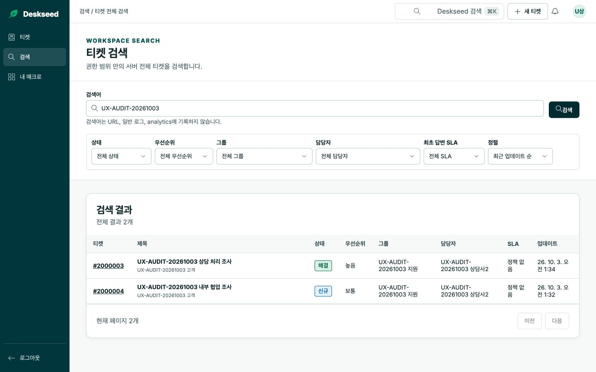
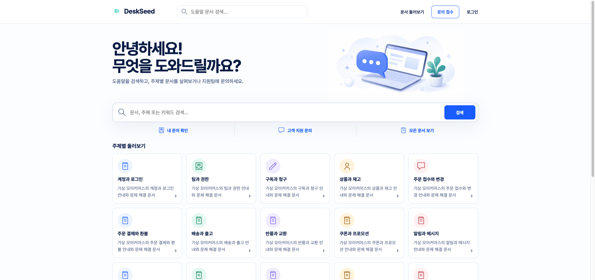
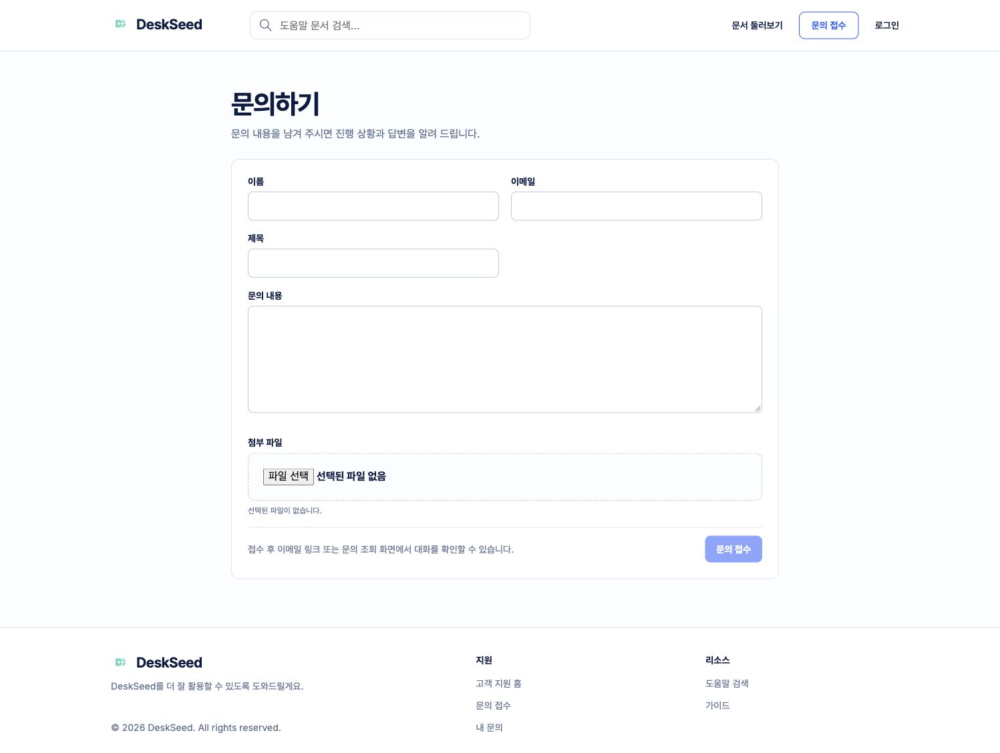
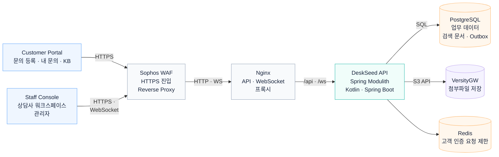

<div align="center">

# DeskSeed

**자체 설치형 티켓 기반 고객지원 시스템**

고객지원 운영 경험을 바탕으로 만든 Kotlin/Spring 개인 프로젝트입니다.

   

**[대표 구현](#highlights) · [화면 둘러보기](#screens) · [아키텍처](#architecture) · [실행 방법](#로컬-실행과-테스트) · [문서](#문서)**

[Core API](api/core-api-outline-v1.yaml) · [설계 결정](docs/portfolio/adr-index.md) · [검증 기록](docs/evidence/release/README.md)

</div>

<a id="highlights"></a>

## 대표 구현

| 주제 | 해결한 문제와 핵심 결과 |
| --- | --- |
| [**100만 건 티켓 검색**](#ticket-search) | 상세 JOIN **22,510건 → 26건** · 최신순 검색의 동일 요청 **4.166초 → 약 50ms** |
| [**여러 상담사의 동시 수정**](#ticket-concurrency) | 다른 필드는 병합, 같은 필드는 충돌 안내 · 재시도에 따른 중복 댓글 방지 |
| [**회원가입 경합 처리**](#registration-race) | 회원가입과 매직 링크 계정 생성이 같은 락을 사용해 불필요한 인증 토큰·메일 발송 요청 방지 |
| [**AI 작업 취소·복구**](#ai-recovery) | 이전 워커의 늦은 상태 변경 차단 · 중단된 작업과 유실된 메시지 복구 |
| [**삭제 문서의 검색 재등장 방지**](#knowledge-consistency) | 임베딩 완료 시 소스 버전 확인 · 답변에 사용할 문서의 현재 권한 재검사 |
| [**변경·열람 감사 기록**](#audit) | 티켓 변경과 감사 기록을 함께 저장 · 필수 열람 기록 실패 시 응답 차단 |

<sub>JOIN 축소와 HTTP 응답시간은 별도 실험에서 측정했습니다. HTTP 수치는 100만 건 합성 티켓을 사용하는 개인 스테이징에서 단일 가상 사용자의 동일 요청을 비교한 결과입니다.</sub>

<a id="screens"></a>

## 화면 둘러보기

| 상담사 티켓 검색 | 고객 도움말 |
| --- | --- |
|  |  |

상담사는 티켓을 검색하고 공개 답변·내부 메모를 작성하거나 다른 담당자에게 이관합니다. 고객은 도움말을 찾아보고, 해결되지 않은 내용은 문의로 접수합니다.

<details>
<summary>문의 등록·티켓 검색 화면 더 보기</summary>

| 고객 문의 등록 | 상담사 티켓 검색 |
| --- | --- |
|  |  |

</details>

### 주요 기능

| 사용자·시스템 | 기능 |
| --- | --- |
| 고객 | 이메일 인증 회원가입, 비밀번호 로그인·재설정, 비밀번호 미설정 고객의 매직 링크 로그인 |
| 고객 문의 | 익명·로그인 문의 접수, 토큰으로 익명 문의 조회, 내 문의 목록과 추가 답변 |
| 상담사 | 티켓 검색·Views, 상태·우선순위·그룹·담당자 변경, 공개 답변·내부 메모·이관 |
| 감사자 | 변경·열람·검색 이력 조회, 권한별 접근, Audit Explorer |
| 외부 시스템 | 허용 네트워크·API key scope 검사, 티켓 생성·조회·변경, `Idempotency-Key`·`If-Match` 처리 |
| AI 어시스턴트 | 공개 대화 요약·분류 제안·공개 도움말 기반 답변 초안. 별도 AI 구성이 필요하며 기본값은 비활성 |

<a id="architecture"></a>

## 아키텍처



고객 포털과 직원 콘솔은 공통 API를 사용하며 인증과 조회 데이터를 분리합니다. PostgreSQL은 티켓·감사·검색 데이터를, VersityGW는 첨부파일을 보관합니다. Redis는 고객 인증 요청 제한에 사용합니다.

[전체 구조](docs/architecture/overview.md) · [티켓 수정과 동시 수정 충돌 처리](docs/architecture/ticket-command.md) · [활성·종료 티켓 검색](docs/architecture/ticket-search.md) · [고객 문의 조회와 공개 답변 분리](docs/architecture/customer-read.md)

업무 기능은 **Java 21 · Kotlin · Spring Boot · Spring Modulith · PostgreSQL**로 구성했습니다. 고객 포털과 직원 콘솔은 각각 독립된 React/TypeScript 앱이며, 같은 도메인에서 서로 다른 API와 화면을 사용합니다.

| 구성 | 역할 |
| --- | --- |
| Spring Modulith 백엔드 | 고객·상담·권한·감사·외부 API 모듈. 모듈 간 의존성은 아키텍처 테스트로 검사 |
| 업무 PostgreSQL | 현재 티켓 상태와 변경·열람 기록 저장. Flyway로 스키마 관리 |
| 고객 인증 Redis | 인증 요청 횟수 제한 |
| 선택 구성: Python AI 서비스 | 모델 호출과 작업 복구. 별도 PostgreSQL/pgvector와 Redis Streams 사용 |

AI 서비스에는 업무 DB 접근 권한을 주지 않고, 백엔드가 현재 권한을 확인해 제공하는 공개 데이터만 전달합니다. 모델 호출은 티켓 트랜잭션 밖에서 실행합니다.

[모듈러 모놀리스 선택](docs/adr/0002-modular-monolith.md) · [고객·직원 앱 분리](docs/adr/0044-customer-portal-frontend-surface-isolation.md) · [AI 실행 경계](docs/adr/0049-ai-v1-isolated-execution-boundary.md)

## 구현 이야기

<a id="ticket-search"></a>

### 1. 100만 건 상담 티켓 검색 최적화

검색 조건에 맞는 티켓 전체에 고객·그룹·담당자·SLA 정보를 JOIN한 뒤 일부만 반환하면서 조회 비용이 커졌습니다. **페이지에 보여줄 티켓을 먼저 선택하고, 선택된 티켓에만 상세 정보를 JOIN**하도록 변경했습니다.

- 동일 검색 조건에서 상세 JOIN 대상 **22,510건 → 26건**
- 별도의 최신순 인덱스 개선 후 동일 요청의 HTTP 응답시간 **4.166초 → 49.899 / 49.748 / 47.876ms**

최신순 검색에서는 기존 인덱스가 전체 검색 결과의 정렬 순서를 바로 제공하지 못했습니다. 요청별 trace로 페이지 조회에 지연이 집중되는 것을 확인한 뒤, `(updated_at DESC, ticket_number DESC) INCLUDE (id)` 인덱스를 추가했습니다.

| 실험 | 측정 조건 |
| --- | --- |
| JOIN 축소 | 같은 검색 조건으로 SQL을 각 4회 실행해 결과와 실행계획 비교 |
| 최신순 인덱스 | 100만 건 합성 티켓, 개인 스테이징, 단일 가상 사용자. 동일 요청의 변경 전 1회와 변경 후 3회 HTTP 응답시간 비교 |

[JOIN 축소 측정](docs/performance/staff-search-two-phase-page.md) · [인덱스 선택과 실행계획](docs/adr/0054-latest-first-staff-search-order-index.md) · [PR #223](https://github.com/kdh949/deskseed/pull/223) · [PR #234](https://github.com/kdh949/deskseed/pull/234)

<details>
<summary>검색 코드와 테스트</summary>

- [검색 SQL 구성](backend/src/main/kotlin/dev/deskseed/ticketing/internal/StaffTicketSearchSqlPlan.kt)
- [검색 Repository](backend/src/main/kotlin/dev/deskseed/ticketing/internal/StaffTicketQueryRepository.kt)
- [검색 통합 테스트](backend/src/test/kotlin/dev/deskseed/staffaccess/internal/AgentTicketSearchIntegrationTest.kt)

</details>

### 검색 성능

100만 티켓이 저장된 개인 스테이징에서 1 VU로 측정했습니다.

| 개선 항목 | 측정 대상 | 결과 |
| --- | --- | --- |
| 검색 흐름 개선 · [PR #237](https://github.com/kdh949/deskseed/pull/237) | 검색 20회의 HTTP 응답 p95 | **22.056초 → 1.601초** |
| 최신순 인덱스 · [PR #234](https://github.com/kdh949/deskseed/pull/234) | 동일 검색 요청의 HTTP 응답시간 | **4.166초 → 47.876~49.899ms** |

검색 흐름 개선에서는 첫 페이지의 전체 건수 계산을 줄이고, 검색 범위가 넓으면 검색어 추가 안내를 반환하도록 바꿨습니다. 변경 전 20건은 모두 결과 목록이었고, 변경 후에는 **결과 목록 15건·검색어 추가 안내 5건**이었습니다. 결과 목록 15건의 p95는 **1.158초**였습니다.

최신순 인덱스 적용 실험은 동일 검색 요청(`topic:3`)을 비교했습니다. 변경 전 HTTP 응답시간은 4.166초였고, 변경 후 세 번의 측정에서는 47.876~49.899ms였습니다.

[검색 흐름과 실험별 측정 조건](docs/architecture/ticket-search.md#성능-개선-측정)

<a id="ticket-concurrency"></a>

### 2. 여러 상담사가 같은 티켓을 수정할 때

두 상담사가 같은 티켓의 상태와 우선순위를 각각 바꾸면 두 변경을 모두 반영합니다. 같은 항목을 수정한 경우에는 먼저 저장된 값을 유지하고, 나중 요청에 충돌을 안내합니다.

티켓 버전과 변경 이력을 비교해 **수정 항목이 겹치지 않으면 최신 상태에 반영하고, 같은 항목이 바뀌었다면 `409`와 충돌 항목을 반환**합니다. 화면에서는 작성하던 답변을 유지합니다.

응답을 받지 못해 같은 요청을 다시 보내는 경우에는 command ID로 기존 처리 결과를 반환합니다. 댓글·티켓 변경·감사 기록은 같은 트랜잭션에 저장해 일부만 남지 않도록 했습니다.

[필드별 동시성 처리의 선택 이유](docs/adr/0007-field-aware-optimistic-concurrency.md) · [처리 범위와 재시도 규칙](tasks/briefs/ticket-update-audit-concurrency.md)

<details>
<summary>동시 수정·중복 요청 코드와 테스트</summary>

- [필드별 충돌 처리와 트랜잭션](backend/src/main/kotlin/dev/deskseed/ticketing/internal/JpaAgentTicketCommandService.kt)
- [충돌 처리와 초안 보존](frontend/apps/staff-console/src/features/ticket-workspace/model/useTicketEditor.ts)
- [동시 수정·중복 요청·감사 실패 테스트](backend/src/test/kotlin/dev/deskseed/staffaccess/internal/AgentTicketCommandIntegrationTest.kt)

</details>

<a id="registration-race"></a>

### 3. 회원가입과 매직 링크가 같은 이메일을 처리할 때

회원가입 코드를 검토하면서, 가입 요청과 기존 고객의 매직 링크 계정 생성이 동시에 진행될 때의 경합을 발견했습니다. 매직 링크는 이메일 링크로 로그인하는 방식이며, 기존 고객에게 계정이 없으면 계정을 생성하는 경로가 있습니다.

두 경로가 서로 다른 락 키를 사용해, 계정 존재 여부 조회와 후속 저장 사이에 계정 생성이 끼어들 수 있었습니다. 이 경우 이미 생성된 계정에도 가입용 인증 토큰·메일 발송 요청이 저장됩니다.

계정의 UNIQUE 제약으로는 별도 테이블에 저장되는 인증 토큰·메일 발송 요청을 막을 수 없어, **두 경로가 정규화된 이메일 기준의 트랜잭션 advisory lock을 공유**하도록 변경했습니다.

[발견 경위와 수정 · PR #142](https://github.com/kdh949/deskseed/pull/142) · [가입 요청의 트랜잭션과 데이터 경계](tasks/briefs/customer-registration-request.md)

<details>
<summary>이메일별 락 처리와 테스트</summary>

- [가입 요청의 계정 확인과 락 처리](backend/src/main/kotlin/dev/deskseed/customerauth/internal/JdbcCustomerRegistrationIntentStore.kt)
- [계정 생성 경로의 락 처리](backend/src/main/kotlin/dev/deskseed/customerauth/internal/CustomerAccountSessionStore.kt)
- [가입 요청과 계정 생성 경합 테스트](backend/src/test/kotlin/dev/deskseed/customerauth/internal/CustomerRegistrationRequestIntegrationTest.kt)

</details>

<a id="ai-recovery"></a>

### 4. AI 작업을 취소하거나 다른 워커가 이어받을 때

AI 작업은 모델 응답을 기다리는 동안 취소되거나 다른 워커로 넘어갈 수 있습니다. 이런 작업은 이전 워커가 늦게 응답을 받아도 상태를 바꾸거나 재시도를 만들지 못하도록 처리했습니다.

재시도마다 바뀌는 `generation`과 작업 인수 때 갱신하는 `lease epoch`를 확인해 **현재 작업을 맡은 워커만 상태를 변경**하도록 했습니다. 실패를 기록할 때도 두 값을 확인합니다.

워커가 중단해 남은 Redis Streams 메시지는 다른 워커가 인수합니다. Stream이 유실된 경우에는 PostgreSQL에 저장한 발송 요청을 바탕으로 다시 전달합니다.

[AI 실행 경계와 대안](docs/adr/0049-ai-v1-isolated-execution-boundary.md) · [작업 중단·복구 운영 절차](docs/runbooks/ai-v1-operations.md)

<details>
<summary>작업 실행·복구 코드와 테스트</summary>

- [메시지 소비와 복구](ai/src/deskseed_ai/queue.py)
- [작업 소유권과 상태 변경](ai/src/deskseed_ai/repository.py)
- [취소·워커 교체·메시지 유실 테스트](ai/tests/test_runtime_integration.py)

</details>

<a id="knowledge-consistency"></a>

### 5. 임베딩 중 삭제된 문서가 다시 검색되지 않도록

공개 도움말 문서를 임베딩하는 동안 문서가 삭제되거나 비공개로 바뀔 수 있습니다. 먼저 시작한 임베딩이 나중에 끝나면 오래된 결과가 삭제 처리를 덮어쓸 수 있습니다.

임베딩 결과를 저장할 때 **문서의 소스 버전과 현재 이벤트를 다시 확인**해, 삭제 이후에 도착한 이전 결과를 반영하지 않도록 했습니다.

검색 인덱스의 삭제 반영을 기다리는 동안에도 철회된 문서가 답변에 쓰이지 않도록, 모델에 내용을 전달하기 전과 결과를 반환하기 전에 현재 공개 상태와 접근 권한을 확인합니다.

[문서 철회·재색인 기준](docs/runbooks/ai-v1-operations.md#public-knowledge-withdrawal-and-reindex) · [AI 구현·검증 범위](docs/tasks/2026-09-16-ai-v1-b-g-runtime.md)

<details>
<summary>문서 인덱싱 코드와 테스트</summary>

- [문서 인덱싱](ai/src/deskseed_ai/indexing.py)
- [임베딩 결과 반영 시 버전 확인](ai/src/deskseed_ai/retrieval.py)
- [임베딩 중 삭제·인용 권한 재검사 테스트](ai/tests/test_runtime_integration.py)

</details>

AI 실행·문서 검색은 합성 모델과 실제 PostgreSQL/pgvector·Redis를 사용하는 통합 테스트로 검증했습니다. 실제 모델의 답변 품질과 운영 부하는 별도 측정 대상입니다.

<a id="audit"></a>

### 6. 변경·열람 기록과 Audit Explorer

티켓을 수정한 사람과 시각, 상담사의 티켓 열람·검색 내역을 기록합니다. 감사자는 Audit Explorer에서 변경·열람 이력을 조회합니다.

**티켓 변경과 변경 이력은 함께 저장하고, 민감한 조회는 필수 열람 기록이 저장된 뒤에 성공 응답을 반환**합니다. 감사 기록 저장에 실패하면 `503`을 반환합니다.

고객에게 보이는 `PUBLIC` 답변과 상담사만 읽는 `INTERNAL` 메모는 서버의 조회 결과부터 분리합니다. 화면의 백그라운드 재조회는 사용자가 의도적으로 티켓을 연 기록과 구분합니다.

[필수 감사 기록 실패 시 처리 기준](docs/adr/0018-strict-audit-write-semantics.md) · [고객·직원 데이터 경계](docs/adr/0044-customer-portal-frontend-surface-isolation.md)

<details>
<summary>감사 조회·저장 코드</summary>

- [Audit Explorer 조회](backend/src/main/kotlin/dev/deskseed/audit/internal/JdbcAuditExplorer.kt)
- [상담사 티켓 조회와 접근 이력 저장](backend/src/main/kotlin/dev/deskseed/staffaccess/internal/AgentTicketReadApplicationService.kt)

</details>

## 로컬 실행과 테스트

Docker Compose로 실행할 수 있습니다. Node.js(`^22.22.2 || ^24.15.0 || >=26.0.0`), npm, Docker, Python 3, `curl`, Chromium용 Playwright가 필요합니다.

**브라우저 테스트**

```bash
npm --prefix frontend ci
npm --prefix frontend exec playwright install chromium
bash scripts/run-frontend-browser-e2e.sh
```

상담사 화면의 접근·Views·워크스페이스 관련 Playwright 테스트 파일 4개를 실행합니다. API 응답에는 테스트 데이터를 사용합니다.

**Docker Compose 통합 테스트**

```bash
# HTTP API smoke test
bash scripts/run-p1-contract-e2e.sh

# 고객 로그인·첨부파일 브라우저 테스트
bash scripts/run-authenticated-customer-attachment-e2e.sh
```

각 스크립트는 별도의 Docker Compose 환경을 만들고 종료할 때 정리합니다. `run-authenticated-customer-attachment-e2e.sh`는 고객 로그인과 첨부파일 사용을 테스트합니다.

**고객·직원 로그인**

고객은 `/customer/register`에서 가입·이메일 인증을 마친 뒤 `/customer/sign-in`에서 로그인합니다. 내 문의는 `/account/requests`에서 조회합니다. 익명 문의는 전용 접근 토큰으로 관리합니다.

직원은 `/agent/login`으로 로그인합니다. 고객 포털과 직원 콘솔은 별도의 React 앱이며, Docker Compose에서 같은 도메인으로 제공합니다.

- [고객 인증 API 호출](frontend/apps/customer-portal/src/features/customer-auth/api/customerAuthClient.ts)
- [현재 Compose 구성](compose.yaml) · [환경 변수 예시](.env.example)

## 문서

- [고객·직원 앱 분리](docs/adr/0044-customer-portal-frontend-surface-isolation.md)
- [고객 비밀번호 인증과 매직 링크의 적용 범위](docs/adr/0042-password-primary-customer-authentication.md)
- [필드별 낙관적 동시성 제어](docs/adr/0007-field-aware-optimistic-concurrency.md)
- [설계 결정](docs/portfolio/adr-index.md)
- [릴리스 테스트 기록](docs/evidence/release/README.md)
- [AI 도구를 사용한 개발 기록](docs/portfolio/ai-and-human-decisions.md)
