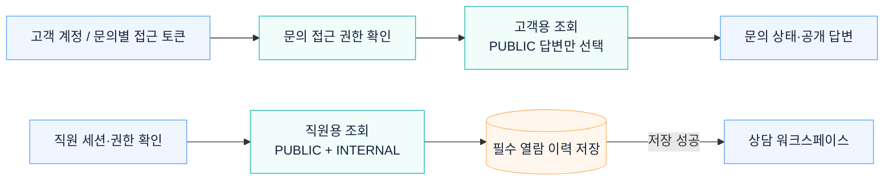

# 고객 문의 조회와 공개 답변 분리

고객 계정 또는 문의별 접근 토큰으로 조회 권한을 확인합니다. 고객에게는 문의 상태와 공개 답변을 반환하고, 내부 메모와 직원용 정보는 직원 조회에서 처리합니다.

## 관련 문서

- [고객·직원 앱 분리 · ADR-0044](../adr/0044-customer-portal-frontend-surface-isolation.md)
- [상담사 조회와 접근 이력 저장](../../backend/src/main/kotlin/dev/deskseed/staffaccess/internal/AgentTicketReadApplicationService.kt)

[시스템 구조](overview.md) · [README](../../README.md#아키텍처)
