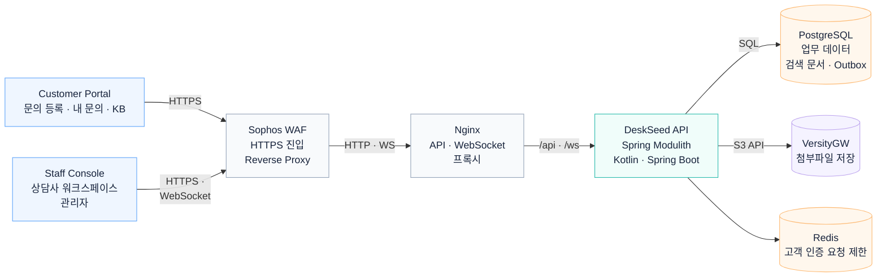

# DeskSeed 시스템 아키텍처

고객 포털과 직원 콘솔은 공통 API를 사용하며 인증과 조회 데이터를 분리합니다. PostgreSQL은 티켓·감사·검색 데이터를, VersityGW는 첨부파일을 보관합니다. Redis는 고객 인증 요청 제한에 사용합니다.

## 기능별 흐름

- [티켓 수정과 동시 수정 충돌 처리](ticket-command.md)
- [활성·종료 티켓 검색](ticket-search.md)
- [고객 문의 조회와 공개 답변 분리](customer-read.md)

## 관련 문서

- [설계 결정](../portfolio/adr-index.md)
- [Core API](../../api/core-api-outline-v1.yaml)

[README](../../README.md#아키텍처)
