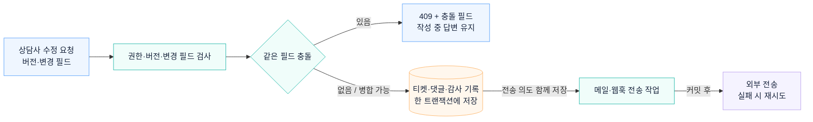

# 티켓 수정과 동시 수정 충돌 처리

티켓 버전과 변경 필드를 비교해 겹치는 수정은 409로 반환합니다. 저장이 가능한 요청은 티켓·댓글·감사 기록을 한 트랜잭션에 반영합니다.

## 관련 문서

- [필드별 동시 수정 충돌 처리 · ADR-0007](../adr/0007-field-aware-optimistic-concurrency.md)
- [티켓 변경 서비스](../../backend/src/main/kotlin/dev/deskseed/ticketing/internal/JpaAgentTicketCommandService.kt)

[시스템 구조](overview.md) · [README](../../README.md#아키텍처)
