# 활성·종료 티켓 검색

```mermaid
flowchart LR
    n_query["검색어·필터 입력<br/>상태 미지정"]:::client
    n_active["활성 티켓 검색"]:::app
    n_enough{"페이지 결과 충분"}:::decision
    n_terminal["종료 티켓 검색"]:::app
    n_ids["페이지 티켓 ID 선택"]:::app
    n_join["고객·그룹·담당자·SLA JOIN"]:::app
    n_audit[("필수 검색 이력 저장")]:::data
    n_response["결과 + 다음 페이지 cursor"]:::client
    n_fail["503 반환"]:::client

    n_query --> n_active
    n_active --> n_enough
    n_enough -->|"충분"| n_ids
    n_enough -->|"부족"| n_terminal
    n_terminal --> n_ids
    n_ids --> n_join
    n_join --> n_audit
    n_audit -->|"저장 성공"| n_response
    n_audit -->|"저장 실패"| n_fail

    classDef client fill:#eff6ff,stroke:#60a5fa,color:#17233b
    classDef edge fill:#f8fafc,stroke:#94a3b8,color:#17233b
    classDef app fill:#f0fdfa,stroke:#2bbbad,color:#17233b
    classDef data fill:#fff7ed,stroke:#fdba74,color:#17233b
    classDef external fill:#f5f3ff,stroke:#bda4ee,color:#17233b
    classDef decision fill:#f0fdfa,stroke:#2bbbad,color:#17233b
```

상태 조건이 없으면 활성 티켓을 먼저 검색하고 결과가 부족할 때 종료 티켓을 이어서 검색합니다. 상태를 지정하면 해당 상태의 티켓을 검색합니다. 페이지에 넣을 티켓을 고른 뒤 상세 정보를 JOIN하고 검색 이력을 저장합니다.

## 관련 문서

- [검색 SQL 계획](../../backend/src/main/kotlin/dev/deskseed/ticketing/internal/StaffTicketSearchSqlPlan.kt)
- [검색 Repository](../../backend/src/main/kotlin/dev/deskseed/ticketing/internal/StaffTicketQueryRepository.kt)

[시스템 구조](overview.md) · [README](../../README.md#아키텍처)
